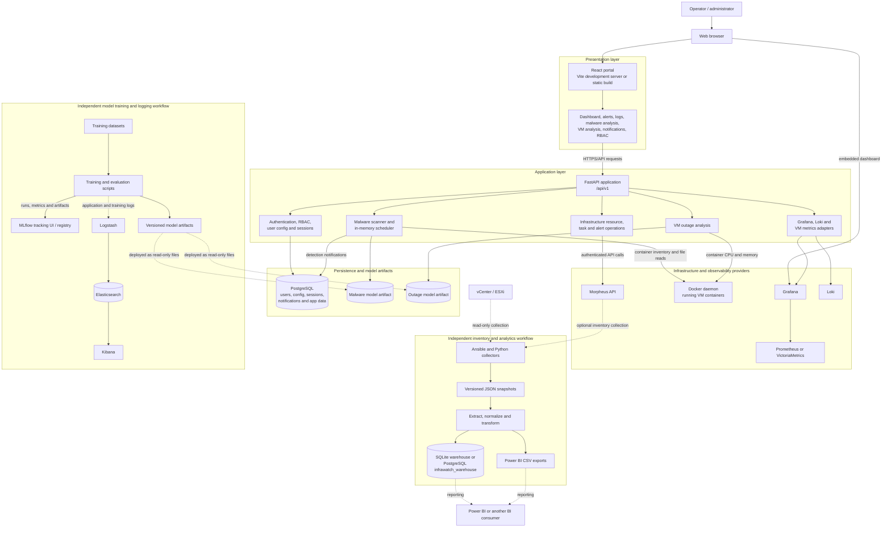
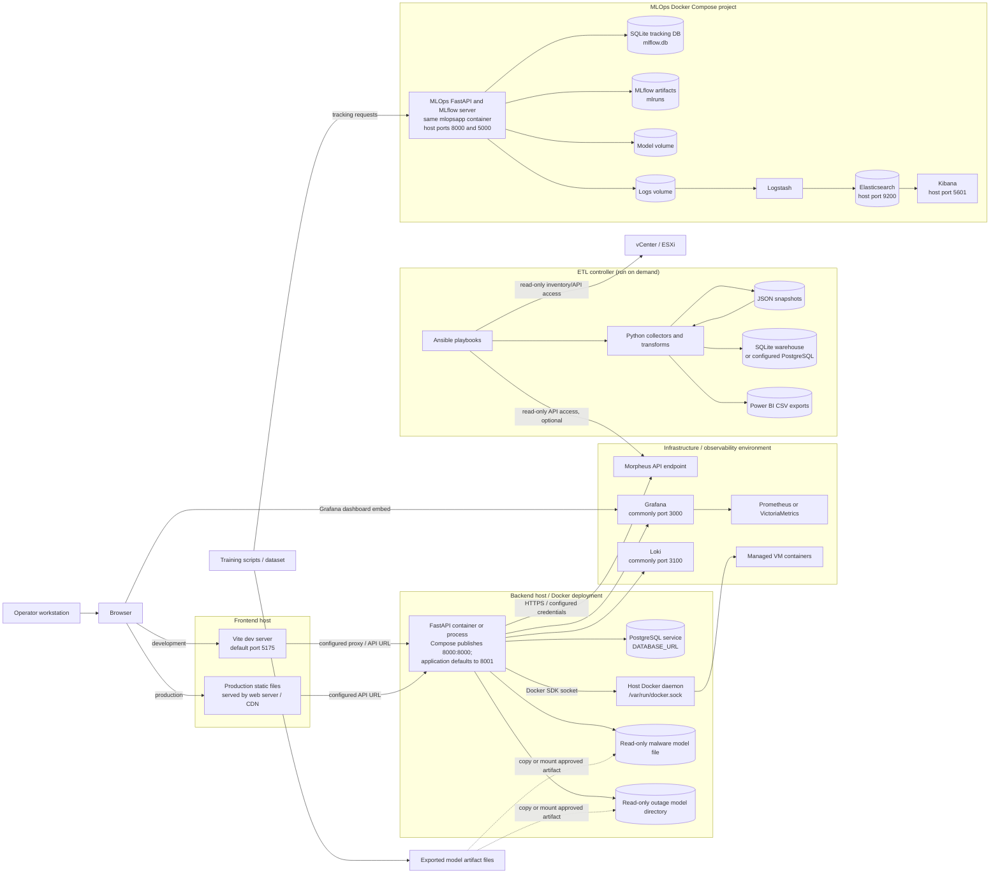

# InfraWatch architecture

This document describes the architecture represented by the current source
code and deployment files. It separates the application's logical components
from the hosts, containers, and external systems that run them. Solid arrows
show data or control flows; dashed arrows indicate optional or configuration-
dependent integrations.

## Logical architecture

### Logical responsibilities and flows

1. The browser renders the React portal and calls the FastAPI `/api/v1`
   endpoints for authentication, resource operations, dashboards, alerts,
   logs, notifications, VM metrics, and malware/outage analysis.
2. FastAPI reads and writes application data in PostgreSQL, calls the
   configured Morpheus API, uses Grafana for dashboard/datasource resolution,
   and queries Loki for log views. Embedded Grafana dashboards query their
   configured Prometheus or VictoriaMetrics datasource.
3. VM metrics and malware analysis use the Docker daemon. Malware scanning
   reads selected running containers, scores files with a mounted model, and
   writes detected-file notifications to PostgreSQL. Recurring schedules are
   held in backend process memory and are lost when that process restarts.
4. ETL is a separate batch workflow: Ansible/Python collection produces JSON
   snapshots, Python transforms and loads them into either SQLite or the
   `infrawatch_warehouse` PostgreSQL schema, and exports CSV files for BI use.
   It does not currently feed the FastAPI request path.
5. Model training is also separate from API request handling. Training scripts
   can record experiments and artifacts in MLflow; deployment copies or mounts
   approved files into the backend. The MLOps FastAPI service and MLflow
   tracking service are distinct from the main FastAPI application.

## Physical / deployment architecture

The diagram is a deployment view, not a claim that all nodes are on the same
machine. The ETL workflow is invoked from a controller with network access to
the source platforms and chosen warehouse. The MLOps Compose project and the
backend Compose project are independent and are not orchestrated by a
repository-root Compose file.

## Deployment notes

- **Confirm API ports before deployment.** The FastAPI application defaults
  to port `8001`, the backend Compose file maps host/container port `8000`,
  and the MLOps Compose file also publishes `8000`. The Vite proxy defaults
  to `localhost:8001`; other frontend modules use `VITE_API_URL` (default
  `http://192.168.100.77:8005`) or an `IP_BASE`-derived `:8001` URL. These
  are deployment-specific settings and must be aligned with the actual
  backend listener and published port. The two Compose projects cannot both
  bind the same host port `8000` simultaneously without changing a mapping.
- **Treat integrations as configurable endpoints.** Morpheus, PostgreSQL,
  Grafana, Prometheus/VictoriaMetrics, and Loki are configured separately;
  their presence on one host is not required by the source layout.
- **Protect the Docker socket.** The backend Compose file mounts
  `/var/run/docker.sock`; this grants the backend powerful control over the
  host's Docker daemon. Use only on a trusted host and restrict access.
- **Persist state deliberately.** Backend PostgreSQL is external to the
  backend Compose service. Malware scan schedules are in-memory. The MLOps
  Compose stack persists Elasticsearch and application data using named
  volumes and local mounts; ETL output is written under `ETL/output/` unless
  another destination is configured.
- **Keep model production and consumption distinct.** Training/export creates
  model files; the backend consumes mounted files for inference. MLflow
  tracking/registry does not automatically promote or deploy an artifact.
- **Configure browser-facing URLs consistently.** The frontend must be able
  to reach its selected API endpoint and Grafana embed URL. In production,
  serve the built frontend and configure an appropriate reverse proxy,
  authentication, TLS, and CORS policy.
